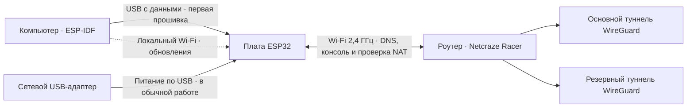

# Контроллер переключения Netcraze на ESP32

[English](README.md)

Обычная ESP32 следит за двумя выходами WireGuard на роутере Netcraze. Для каждой пробы она проверяет HTTPS и NAT на роутере. После трёх подряд измеренных сбоев плата может перенести заданные маршруты и DNS-привязки на резервный туннель. При ошибке проверки она возвращает исходные привязки. После настройки по USB плату можно питать от розетки и обновлять прошивку по локальному Wi-Fi.

## Схема подключения



Для первой прошивки подключите плату к компьютеру кабелем с передачей данных. После настройки плату можно питать от розетки, а статус и обновления получать по локальной сети. ESP32 выполняет пробы и меняет привязки на роутере. Трафик домашних устройств идёт через роутер и его туннели WireGuard.

**Установка с Codex или Claude Code.** Откройте скачанный репозиторий и отправьте агенту [готовый запрос](INSTALL_WITH_AGENT.md#по-русски).

## Что понадобится

- Обычная ESP32 с флеш-памятью от 4 МБ, USB-кабель с передачей данных для настройки, питание USB и Wi-Fi 2,4 ГГц.
- Netcraze Racer с двумя рабочими подключениями WireGuard, локальной консолью Telnet, доступом к DNS роутера и таблице TCP NAT. Для других моделей и версий роутера нужно проверить совместимость.
- ESP-IDF 5.5.x и Python 3. См. [инструкцию Espressif](https://docs.espressif.com/projects/esp-idf/en/v5.5/esp32/get-started/).
- Контрольные HTTPS-пробы проверяют YouTube (204), ChatGPT (200) и Codex (200). Оба выхода должны пропускать эти пробы. Готовые профили WireGuard настраивает оператор.

### Netcraze и Keenetic

Netcraze — новый бренд компании, которая раньше поставляла Keenetic в ЕАЭС. В официальных каталогах есть [Netcraze Racer NC-4010](https://netcraze.ru/ru/netcraze-racer) и [Keenetic Racer KN-4010](https://keenetic.com/de/keenetic-racer). Контроллер проверен на Netcraze Racer. С Keenetic Racer начните с наблюдения и перед записью маршрутов сверьте вывод консоли, политики для каждого туннеля и результаты HTTPS/NAT. Совместимость зависит от модели и версии прошивки роутера. [Разъяснение Netcraze](https://support.netcraze.ru/giga/nc-1012/en/51147-is-it-possible-to-use-keenetic-and-netcraze-models-together-.html)

## 1. Настройте роутер

1. Настройте два рабочих туннеля и создайте две политики в приоритетах подключений. В каждой политике разрешите ровно один глобальный интерфейс WireGuard. Резерв через провайдера в этих политиках отключите.
2. Зарегистрируйте ESP32 в локальной сети с политикой сегмента по умолчанию (`conform`). DNS и консоль роутера должны быть доступны из обеих политик проверки. Во время проб плата временно меняет политику только для себя. Для удобства обновлений можно закрепить её IP через DHCP.
3. Разрешите Telnet в доверенной локальной сети и используйте учётную запись с правами на нужные команды. Telnet передаёт учётные данные открытым текстом, а эта сборка хранит их в незашифрованном NVS. Оставьте Telnet и порт ESP32 8266 внутри доверенной сети.
4. Команда `show running-config` показывает точные имена интерфейсов, политик и существующие привязки. Для переключения все управляемые привязки сначала должны вести через один туннель. Поддерживаются статические IPv4-маршруты с `auto`, маршруты DNS-групп с `auto reject` и привязки отдельных доменов вида `ip name-server <resolver> <hostname> on <interface>`. Общие резолверы туннелей и прочие настройки сохраняют текущие привязки.

## 2. Соберите прошивку

```sh
idf.py set-target esp32
idf.py menuconfig
```

В разделе **Netcraze failover** задайте IPv4 роутера, имена двух интерфейсов и двух политик. Для режима наблюдения оставьте имя контрольного хоста пустым и пропустите настройку файла привязок. Для теста переключения:

```sh
cp main/site_config.example.h main/site_config.h
```

Замените демонстрационные записи привязками своего роутера. В разделе **Netcraze failover** укажите контрольный домен, путь и ожидаемый HTTPS-статус. Домен должен быть доступен по публичному IPv4, идти по управляемым маршрутам и стабильно отдавать выбранный статус. После переключения плата проверяет его через новый выход со своей обычной политикой.

Для обновлений по Wi-Fi создайте отдельный ключ перед первой прошивкой:

```sh
python3 provision-ota-key.py
idf.py -p <serial-port> flash monitor
```

Для обновлений только по USB достаточно второй команды. По подсказкам введите имя сети Wi-Fi, пароль, логин роутера и пароль роутера, каждый на собственной строке. Плата сохранит их после проверки подключения и входа. IP платы появится в журнале и списке клиентов роутера. Дождитесь успешных проб для обоих выходов и восстановления политики платы.

Ключ, сгенерированный заголовок и установочный бинарник с ключом храните локально. После первой настройки удалите `main/ota_bootstrap.h` и выполните `idf.py fullclean` перед сборкой следующих обновлений. Локальный `ota.key` нужен программе загрузки. Держите локальные конфигурации и сгенерированные образы вне Git.

## 3. Проверьте переключение и включите автоматику

Отправьте `test-failover` с переводом строки через USB-консоль на скорости 115200 бод. Оба выхода должны пройти штатные пробы. Плата один раз перенесёт привязки, сверит таблицу маршрутов, проверит контрольный HTTPS-запрос и NAT, затем вернёт исходные правила. Тестируйте в момент, когда допустимо короткое переключение трафика.

После успешного теста в рамках той же загрузки отправьте `arm-failover`. Флаг сохраняется при перезагрузке. Команда `disarm-failover` выключает автоматику. Управляйте привязками одним контроллером. Перед изменением списка привязок выключите автоматическое переключение и убедитесь, что восстановление на роутере завершено.

Штатный интервал — 60 секунд. Для автопереключения плата должна восстановить свою обычную политику, получить три измеренных отказа подряд на активном туннеле, успешные HTTPS/NAT-пробы резерва и рабочий UDP DNS роутера. Прошивка сохраняет новые привязки после повторного чтения конфигурации и контрольной пробы. Журнал NVS помогает восстановить весь набор после ошибки или прерванной записи. Проверки одинаковы в обоих направлениях. Текущий выход остаётся активным до следующего подтверждённого отказа или вмешательства оператора.

## 4. Питание от розетки и обновления по Wi-Fi

```sh
python3 update-wifi.py --host <esp32-ip>
idf.py -D PROJECT_VER=my-version build
python3 update-wifi.py --host <esp32-ip> build/netcraze_esp32_observer.bin
```

Утилита подписывает одноразовый запрос, хеш и размер образа локальным ключом. После перезапуска она сверяет идентификатор образа. Резервный слот подтверждается после успешного круга проб хотя бы через один выход. Если проверка не укладывается в три минуты, плата откатывается. Загрузчик и разметку флеша меняйте через USB.

Статус показывает результаты последнего круга после загрузки. Маска `7` означает, что прошли все три пробы для указанного выхода и типа проверки. Значение `probe_policy_restored=1` подтверждает восстановление обычной политики платы в этом круге.

## Проверка

```sh
cc -std=c11 -Wall -Wextra -Werror -Imain tests/observation.c -o /tmp/netcraze-observation-test
/tmp/netcraze-observation-test
```

Исходный контроллер проверен на обычной ESP32 и Netcraze Racer. Проверены перенос маршрутов и DNS-привязок, возврат, питание от розетки и обновление по Wi-Fi. Публичная версия собрана на ESP-IDF 5.5.4 и прошла тест выбора маршрута на компьютере. Для публичной конфигурации ещё нужен отдельный живой прогон.
